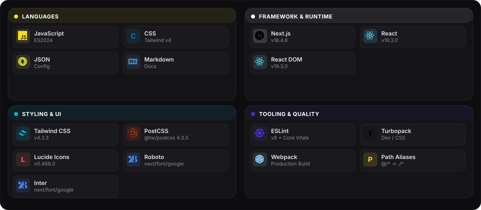
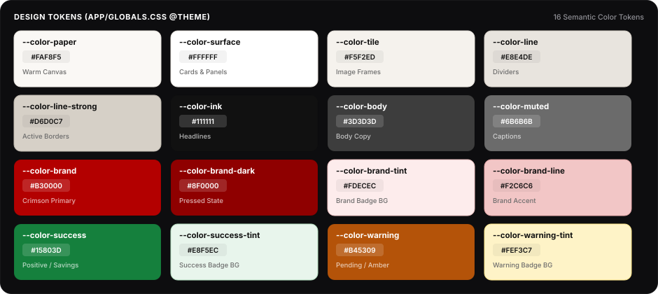

# Vardhman School Uniforms

<p align="center">
  <picture>
    <source media="(prefers-color-scheme: dark)" srcset="docs/readme/banner-dark.svg" />
    <source media="(prefers-color-scheme: light)" srcset="docs/readme/banner-light.svg" />
    
  </picture>
</p>

<p align="center">
  <a href="https://git.io/typing-svg">
    
  </a>
</p>

<p align="center">
  <a href="https://nextjs.org/"></a>
  <a href="https://react.dev/"></a>
  <a href="https://tailwindcss.com/"></a>
  <a href="https://developer.mozilla.org/en-US/docs/Web/JavaScript"></a>
  <a href="https://lucide.dev/"></a>
  
</p>

<p align="center">
  <a href="#-overview">Overview</a> · <a href="#-tech-stack--languages">Tech Stack</a> · <a href="#-architecture">Architecture</a> · <a href="#-design-system--tokens">Design System</a> · <a href="#-project-structure">Structure</a> · <a href="#-getting-started">Getting Started</a> · <a href="#-code-quality">Code Quality</a>
</p>

---

## 📌 Overview

**Vardhman School Uniforms & Dresses** (Est. 1979) is a mobile-first e-commerce storefront that lets students and parents browse certified institutional uniforms, filter by school and board affiliation, and shop a curated catalog of regulation garments and accessories.

The application renders static catalog pages as React Server Components for fast initial loads, and scopes client-side interactivity to precise boundaries — carousels, drawers, filters, and reactive shopping state — to minimise the JavaScript bundle shipped to the browser.

### Highlights

<table>
  <tr>
    <td width="50%" valign="top">
      <h4>🏫 School-Centric Navigation</h4>
      <p>Browse uniforms filtered by institution, board (CBSE, ICSE, State), grade tier, and house colour. Each school card surfaces its regulation palette and emblem.</p>
    </td>
    <td width="50%" valign="top">
      <h4>📱 Mobile-First Interface</h4>
      <p>Fixed bottom navigation bar, horizontal snap scrollers, bottom-sheet drawers, and responsive grids that prioritise single-handed handheld usage.</p>
    </td>
  </tr>
  <tr>
    <td width="50%" valign="top">
      <h4>🛡️ Flicker-Free Client State</h4>
      <p>Cart, wishlist, and profile state powered by <code>useSyncExternalStore</code> with server-safe fallback snapshots — zero hydration mismatch, zero flash of empty UI.</p>
    </td>
    <td width="50%" valign="top">
      <h4>♿ Accessible &amp; Touch-Ready</h4>
      <p>Minimum 44 px touch targets, semantic ARIA roles, keyboard-navigable drawers, crimson focus rings, and <code>prefers-reduced-motion</code> compliance on carousels.</p>
    </td>
  </tr>
</table>

---

## 🛠️ Tech Stack &amp; Languages

Built on modern JavaScript (ES2024) with zero TypeScript compilation overhead. The production build uses Webpack via `next build --webpack`; the dev server uses Turbopack for instant CSS reloads.

<p align="center">
  
</p>

<p align="center">
  
</p>

### Dependencies &amp; Versions

| Layer | Technology | Version | Purpose |
| :--- | :--- | :--- | :--- |
| **Framework** | [Next.js](https://nextjs.org/) | `16.4.6` | App Router, React Server Components, Partial Prefetching |
| **UI Runtime** | [React](https://react.dev/) | `19.3.0` | Concurrent rendering, `useSyncExternalStore`, Suspense |
| **DOM Bindings** | `react-dom` | `19.3.0` | Server and client DOM reconciliation |
| **Styling Engine** | [Tailwind CSS](https://tailwindcss.com/) | `4.3.3` | CSS `@theme` variables, zero-runtime utility classes |
| **Build CSS** | `@tailwindcss/postcss` | `^4.3.5` | PostCSS plugin for production CSS compilation |
| **Dev CSS** | `@tailwindcss/turbopack` | `4.3.3` | Turbopack loader for instant dev-mode CSS |
| **Iconography** | [Lucide React](https://lucide.dev/) | `^0.468.0` | Tree-shakeable SVG icon components |
| **Linter** | [ESLint](https://eslint.org/) | `^9` | Flat config with `eslint-config-next` Core Web Vitals |
| **Lint Preset** | `eslint-config-next` | `16.4.6` | Next.js-specific lint rules and accessibility checks |
| **Fonts** | Roboto + Inter | `next/font/google` | Variable-loaded with `font-display: swap` |
| **Path Aliases** | `jsconfig.json` | — | `@/*` resolves to `./*` for clean imports |

### npm Scripts

| Script | Command | Description |
| :--- | :--- | :--- |
| `npm run dev` | `next dev` | Start dev server with Turbopack |
| `npm run build` | `next build --webpack` | Production build via Webpack |
| `npm start` | `next start` | Serve the production build |
| `npm run lint` | `eslint` | Run ESLint across all source files |

---

## 🏛️ Architecture

The application follows a strict layered architecture where data flows top-down from server-rendered pages into interactive client components, through hydration-safe context providers, and down to static data sources.

<p align="center">
  
</p>

### Architectural Principles

- **Server Components by default.** Pages, layouts, and static catalog listings render on the server. Client JavaScript is shipped only where interactivity is required.
- **Explicit client boundaries.** The `"use client"` directive is scoped narrowly to carousels, reactive stores, filters, and modal drawers — never applied to entire pages.
- **Hydration safety through `useSyncExternalStore`.** All persistent client state (cart, wishlist, profile) uses React 19's `useSyncExternalStore` with deterministic server snapshots, eliminating SSR/client mismatches.
- **Stateless data layer.** Catalog data, school registries, and hero content are plain JavaScript modules with no runtime fetching, keeping the initial render path dependency-free.

---

## 🎨 Design System &amp; Tokens

All visual styling is defined as CSS custom properties inside the Tailwind v4 `@theme` block in `app/globals.css`. The design language combines a warm paper texture with high-contrast typography and a signature crimson accent.

<p align="center">
  
</p>

### Typography

| Role | Family | Weight | Size | Notes |
| :--- | :--- | :--- | :--- | :--- |
| Headlines (`.type-h1`) | Roboto → Inter | 700 | `clamp(1.75rem, 4vw, 2.75rem)` | Tight tracking, `line-height: 1.15` |
| Section Titles (`.type-h2`) | Roboto → Inter | 700 | `clamp(1.25rem, 2.5vw, 1.625rem)` | `line-height: 1.25` |
| Card Titles (`.type-h3`) | Roboto → Inter | 500 | `1rem` | `line-height: 1.35` |
| Body (`.type-body`) | Roboto → Inter | 400 | `0.8125rem (13px)` | `line-height: 1.25rem` |
| Eyebrow (`.type-eyebrow`) | Roboto → Inter | 500 | `0.625rem (10px)` | Uppercase, wide tracking |
| Price (`.type-price`) | Roboto → Inter | 700 | Contextual | Tabular lining numerals |

### Spacing, Radii &amp; Shadows

| Token | Value | Usage |
| :--- | :--- | :--- |
| `--radius-card` | `12px` | Content cards, dialogs, product tiles |
| `--radius-btn` | `6px` | Buttons, inputs, size selectors |
| `--radius-pill` | `9999px` | Header pill, chips, status badges |
| `--shadow-soft` | `0 1px 3px rgba(0,0,0,0.05), 0 1px 2px rgba(0,0,0,0.03)` | Standard card elevation |
| `--shadow-card` | `0 4px 14px rgba(0,0,0,0.06), 0 1px 3px rgba(0,0,0,0.04)` | Floating header, hover-lifted cards |

### Motion Timing

| Constant | Value | Context |
| :--- | :--- | :--- |
| `HERO_INTERVAL_MS` | `6000` | Hero slideshow auto-advance interval |
| `SLIDER_INTERVAL_MS` | `6000` | Category slider auto-advance interval |
| `SLIDE_DURATION_MS` | `700` | Slide transition duration (cubic ease) |
| `SLIDE_DIRECTION` | `"rtl"` | Right-to-left carousel translate direction |

### Touch &amp; Layout

- **Minimum touch target**: 44 px across all interactive elements.
- **Page container**: `max-w-[1280px]` with responsive horizontal padding (`px-4` / `md:px-6` / `lg:px-10`).
- **Bottom nav clearance**: `pb-20 md:pb-0` on `<main>` to clear the fixed mobile navigation bar.
- **Dark mode defence**: `color-scheme: only light` enforced on `<html>`, `<body>`, and viewport meta to prevent browser auto-dark inversion.

### UI Primitives (`components/ui/`)

`Badge` · `Chips` · `OrderStepper` · `ProductImage` · `QtyStepper` · `SearchBar` · `SectionHeader` · `Tabs` · `Toast`

---

## 📁 Project Structure

```
VARDHMAN-SCHOOL-UNIFORMS/
├── app/                        # Next.js App Router: layouts, pages, global CSS
├── components/
│   ├── home/                   # Homepage: hero slideshow, category slider, sections
│   ├── layout/                 # Header, BottomNav, Footer, BrandLogo
│   ├── product/                # Product cards, filters, size selectors
│   ├── profile/                # Account management, profile modal
│   └── ui/                     # Design system primitives (Badge, Toast, Tabs…)
├── context/                    # React context providers (Cart, Wishlist, Profile)
├── data/                       # Static catalog: products, schools, categories, orders
├── lib/                        # Utilities: class merger (cn), formatters, global config
├── public/
│   ├── brand/                  # Official VSU brand logo
│   └── images/                 # Product photos, hero slides, school crests, categories
├── services/                   # Service layer abstractions and data fetchers
├── docs/                       # Documentation and README assets
├── next.config.mjs             # Next.js configuration (Turbopack, Partial Prefetching)
├── postcss.config.mjs          # PostCSS with @tailwindcss/postcss
├── eslint.config.mjs           # ESLint flat config with Core Web Vitals
├── jsconfig.json               # Path alias: @/* → ./*
└── package.json                # Dependencies and npm scripts
```

---

## 🚀 Getting Started

### Prerequisites

- **[Node.js](https://nodejs.org/)** `v18.18+` (Node `v20+` LTS recommended)
- **npm** (bundled with Node.js)

### Installation

1. **Clone the repository:**
   ```bash
   git clone https://github.com/R3DH47-ui/VERDHMAN-DRESSES-WEB.git
   cd VERDHMAN-DRESSES-WEB
   ```

2. **Configure environment:**
   Copy the provided example environment file for your local configuration.

3. **Install dependencies:**
   ```bash
   npm install
   ```

4. **Start the development server:**
   ```bash
   npm run dev
   ```
   Open [http://localhost:3000](http://localhost:3000) in your browser.

---

## ✅ Code Quality

- **Pure JavaScript** — zero TypeScript, zero compilation step, clean ES Modules throughout.
- **Zero Hydration Mismatches** — all client stores use `useSyncExternalStore` with static server snapshots; no browser-only globals evaluated during SSR.
- **Strict Linting** — ESLint v9 flat config with `eslint-config-next` Core Web Vitals preset enforces accessibility and performance rules.
- **Semantic HTML** — `<nav>`, `<main>`, `<section>`, `<article>` landmarks with ARIA labels; keyboard-navigable modals with focus trapping and `Escape` to close.

---

## 📄 License &amp; Attribution

&copy; 1979&ndash;2026 **Vardhman School Uniforms & Dresses**. All rights reserved.
*All institutional insignias, school emblems, and registered uniform designs are the property of their respective partner institutions.*

---

<p align="center">
  
</p>

<p align="center">
  <sub>Built with care for <strong>Vardhman School Uniforms &amp; Dresses</strong> • Est. 1979</sub>
</p>
